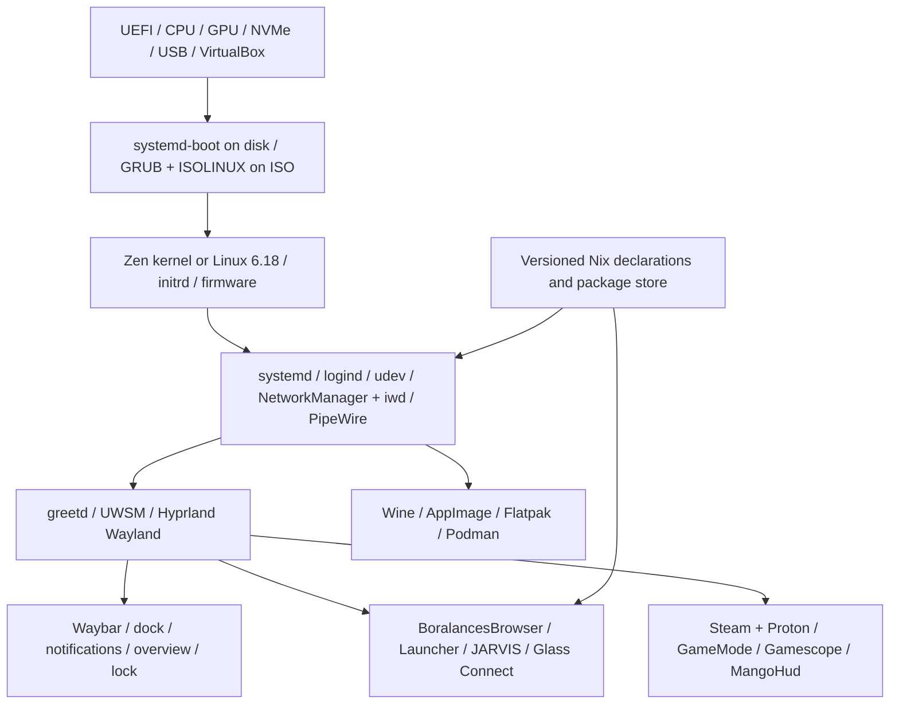

# BoralancesOS architecture

## Product contract

BoralancesOS is an x86_64 Linux desktop for focused work and gaming. The base is a stable NixOS channel pinned to a source revision, updated deliberately and rebuilt as a unit. This trades the smallest possible package store for declarative recovery, auditable image composition and a consistent application environment.

“Lightweight” describes background CPU, memory and service activity. Shipping Steam, several Java runtimes, QtWebEngine and an Electron launcher increases download/storage size; those apps do not need to be running at idle. A gaming edition with all requested projects should not be marketed as a tiny ISO.

## Layers

Systemd is the init and service manager. Systemd-boot is the installed UEFI boot manager, not an init system. ISO boot uses NixOS's hybrid image support. The current installed-system path requires UEFI; BIOS boot of live media does not imply BIOS support in the installer script.

## Performance envelope

| Metric | Acceptance target | Measurement |
|---|---|---|
| Idle RAM | Below 800,000,000 bytes | `MemTotal - MemAvailable`, 120 seconds after installed desktop login, applications closed |
| Kernel + userspace startup | Below 8 seconds on reference NVMe hardware | `systemd-analyze`, excluding firmware and deliberate boot menu wait |
| Login to usable desktop | Below 2 seconds | Timestamped greetd/session startup trace |
| Unchanged desktop | No continuous decorative rendering | GPU/CPU trace over 60 seconds |
| 144 Hz frame budget | 6.94 ms per frame | Presentation-time/frametime analysis on reference GPU |
| Input | Minimize compositor queueing | Latency instrument or high-speed camera; never claim zero latency |

These are design/release targets, not measured results. Establish AMD/Intel/NVIDIA and VM baselines independently. A RAM ledger of roughly 170–250 MB kernel/system, 100–180 MB compositor, 45–100 MB shell and 80–160 MB audio/network/portals leaves limited headroom; the real driver stack decides whether the target is feasible. GPU memory is reported separately, not hidden in a process-RSS sum. The live ISO's squashfs and writable overlay make it unsuitable for the installed-memory acceptance run.

No browser, Electron app, AI listener, microphone monitor, container or game launcher starts automatically. Bluetooth starts powered off. SSH, printing and Avahi are disabled. NetworkManager's wait-online service is disabled. Podman is daemonless. PipeWire and portals follow session/socket activation. Journal sizes are bounded; trim and garbage collection run periodically rather than as continuous workers.

A first-run welcome appears once and exits on dismissal. The menu bar, dock and launcher share original app icons; Control Center is started only when opened. Plymouth runs during boot/shutdown and exits before the interactive desktop. The idle-memory acceptance run closes the welcome and other applications.

## Kernel and hardware policy

Use `linuxPackages_zen` for the general desktop and a Linux 6.18 fallback/VirtualBox image. Do not stack an arbitrary BORE patch on an already patched scheduler. Maintain a cacheable general-purpose kernel for release media. Preserve USB storage, AHCI, NVMe, virtio, VMSVGA, common graphics, input, sound and wireless support.

The optional `modules/kernel-minimal.nix` demonstrates a machine-specific Zen rebuild removing amateur radio, ISDN, ATM and FireWire. It is excluded from universal images. Driver trimming must follow a hardware inventory; unloaded modules primarily cost storage, and deleting broadly useful drivers does not automatically improve throughput. Evaluate PREEMPT, scheduler and frequency-policy changes with frametime and power measurements. Preserve CPU security mitigations and normal ASLR.

Zram uses Zstandard with a 25% maximum memory allocation. Swappiness is set for compressed swap rather than copied from a disk-swap tuning guide. No global CPU governor is forced to performance; GameMode requests changes around games and restores them afterward.

## System layout

| Path | Responsibility |
|---|---|
| `/nix/store` | Immutable package/system closures |
| `/nix/var/nix/profiles/system` | Active system profile and prior generations |
| `/etc/nixos/boralances` | Installed configuration source and generated hardware module |
| `/etc/xdg` | System desktop defaults |
| `~/.config/hypr/local.lua` | User monitor/keyboard/compositor overrides loaded last |
| `~/.config/boralances/state.json` | Appearance and effects preferences |
| `~/.local/share/boralances-browser` | Linux browser profile/bookmarks/workspace |
| `$XDG_CONFIG_HOME/BoralancesLauncher/data` | Electron launcher's Linux app data, via Electron appData |
| `~/.local/share/boralances-jarvis/notes.txt` | Local Linux notes |
| `~/.local/share/boralances/wine/default` | Windows application compatibility prefix |
| `~/.local/share/containers` | Rootless Podman storage |
| `~/.local/share/flatpak` | User-installed Flatpak apps |
| `/nix/.rw-store` | Persistent live overlay backing volume in persistent ISO mode |

OS changes are Nix module changes. User app data remains mutable. A rollback returns a previous system generation; it is not an application-data backup. Preserve old generations until the new kernel, graphics stack and browser have passed smoke tests.

## Graphics and security boundaries

Wayland native rendering is preferred; XWayland supports legacy apps/games. Hyprland and its portal come from the same nixpkgs input. The base compositor configuration uses the Lua API of the pinned 0.55 package family. Screen sharing uses the desktop portal; there is no always-on screen capture server.

The native browser exposes no Python bridge to web pages. Downloads ask for a path and never execute automatically. Private windows use off-the-record profiles. The launcher keeps context isolation and renderer sandbox settings from its source and rejects Electron's plaintext credential backend on Linux. Reauthentication is required; Windows DPAPI blobs are not transferable.

No automatic `.exe` binfmt handler is registered: file-manager association routes explicit opening through Wine. AppImage execution is registered through NixOS's wrapper. Neither Wine nor AppImage is a security sandbox. Optional containers and Flatpak permissions remain separate concerns.

## Official implementation references

- [NixOS stable manual](https://nixos.org/manual/nixos/stable/): configuration, generations and installation.
- [Pinned ISO module](https://github.com/NixOS/nixpkgs/blob/1f607aa79b6356ed45d3cd3c8079c196e79efa2c/nixos/modules/installer/cd-dvd/iso-image.nix): hybrid boot and live store overlay.
- [Pinned VirtualBox guest module](https://github.com/NixOS/nixpkgs/blob/1f607aa79b6356ed45d3cd3c8079c196e79efa2c/nixos/modules/virtualisation/virtualbox-guest.nix): guest service conditions and session-specific clients.
- [Hyprland Lua migration](https://hypr.land/news/26_lua/) and [current control API](https://wiki.hypr.land/configuring/core/advanced-configuration/using-hyprctl/).
